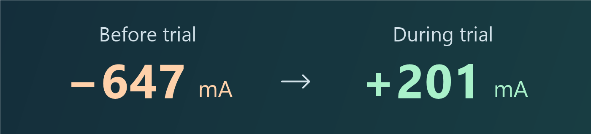

# Legacy iPad USB Charging

<p align="center"><strong>Charge an older iPad while it stays connected over USB for data.</strong></p>

<p align="center">
  <a href="https://github.com/xaer981/legacy-ipad-charge/releases"><strong>Downloads</strong></a> ·
  <a href="#quick-start-windows">Quick start Windows</a> ·
  <a href="#quick-start-linux">Quick start Linux</a> ·
  <a href="#devices">Devices</a> ·
  <a href="#daily-use">Daily use</a> ·
  <a href="docs/README.md">Documentation</a>
</p>

<p align="center">
  <a href="#quick-start-windows"></a>
  <a href="#quick-start-linux"></a>
  <a href="LICENSE"></a>
  <a href="https://boosty.to/xaer981"></a>
</p>

<p align="center"></p>
<p align="center"><a href="#test-results">Battery current on an iPad 2 during a 2 A trial on Windows 11</a></p>

## Problem

An older iPad can lose battery charge while plugged into a computer, especially when used as a second screen or dashboard at full brightness. This tool tells supported iPads that more charging current is available on a compatible USB connection while keeping USB data active.

## Before you start

Use one [listed iPad](#devices) and a USB data cable. Jailbreak is optional. With stock iOS, you can check the charging indicator or use a USB meter. With jailbreak and SSH access, you can log battery current. [How to verify charging](docs/README.md#verify-charging)

## Quick start

Both builds include the .NET runtime. [Quick start Windows](#quick-start-windows) · [Quick start Linux](#quick-start-linux)

### Quick start Windows

Tested on Windows 11 x64. [Windows 10 status](docs/libusb-charge.md#windows-10-x64-untested) · [Switch to Linux](#quick-start-linux)

#### 1. Check your USB port

Connect the iPad and check that Windows recognizes it. For the first trial, confirm that the port, cable, and any adapter or hub support **1 A at 5 V with USB data**. Stay at the standard USB setting if you can't confirm the rating. [How to check the USB port](docs/README.md#check-the-usb-port)

> [!TIP]
> In my setup, a **USB-A → USB-C adapter** let me use the iPad's original USB-A data cable with a higher-current USB-C port on my PC. Check the ratings of the specific port and adapter you use.

#### 2. Download the driver

Download `libusb-win32-bin-1.4.0.2.zip` from the [libusb-win32 release](https://github.com/mcuee/libusb-win32/releases/tag/release_1.4.0.2) and extract the entire ZIP. The app uses this signed package to add a filter for the connected iPad alongside the existing Apple driver. [Verify the download](docs/libusb-charge.md#verify-the-downloads)

#### 3. Download the Windows app

Download `legacy-ipad-charge-windows-x64.zip` from [Releases](https://github.com/xaer981/legacy-ipad-charge/releases) and extract it. Note the folder containing `legacy-ipad-charge.exe`. [Verify the download](docs/libusb-charge.md#verify-the-downloads)

#### 4. Install the filter and reconnect

If you already installed the filter, run `.\legacy-ipad-charge.exe charge check` from the app folder. If it reports `PASS`, go to step 5. [Troubleshoot an existing filter](docs/libusb-charge.md#troubleshooting)

Open **PowerShell as administrator** from the Start menu. Replace the first path with the folder containing the app and the second with the `bin` folder inside the extracted driver ZIP. You can copy each path from the File Explorer address bar.

```powershell
Set-Location "C:\path\to\legacy-ipad-charge"
.\legacy-ipad-charge.exe filter install --bin "C:\path\to\libusb-win32-bin-1.4.0.2\bin"
```

Keep the path printed after `Rollback file:`. Unplug the iPad, reconnect it to the same USB port, and check the filter.

```powershell
.\legacy-ipad-charge.exe charge check
```

Continue when you see `PASS`. [Installation details](docs/libusb-charge.md#install-the-device-filter) · [If the check fails](docs/libusb-charge.md#troubleshooting)

#### 5. Try 1 A, then enable charging

Save the verified 1 A limit for this USB connection.

```powershell
.\legacy-ipad-charge.exe charge confirm-port --max-ma 1000
```

After `PORT_LIMIT_SAVED`, start the 30-second trial. Look for `RAISE_OK` and `RESTORE_OK`.

```powershell
.\legacy-ipad-charge.exe charge trial
```

If both messages appear and charging and USB data worked during the trial, enable 1 A without a timer. [Verify charging on the iPad](docs/README.md#verify-charging)

```powershell
.\legacy-ipad-charge.exe charge enable --limit-ma 1000
```

Look for `ENABLE_OK`. To return to 500 mA, run `.\legacy-ipad-charge.exe charge restore`. [Set up 1.5 A or 2 A](#daily-use) · [Remove the filter](docs/libusb-charge.md#remove-the-device-filter)

### Quick start Linux

Use a glibc-based Linux x64 system and connect the iPad to a native USB port for charging. **Native Linux charging verification is pending.** Use WSL and virtual machines with USB passthrough for diagnostics. A guest USB path can hide the physical port. [Kali WSL results](docs/compatibility.md#linux) · [Switch to Windows](#quick-start-windows)

#### 1. Check the USB connection

Connect one supported iPad using a USB data cable and unlock it. For the first trial, confirm that the port, cable, and any adapter or hub support **1 A at 5 V with USB data**. [How to check the USB port](docs/README.md#check-the-usb-port)

#### 2. Download and extract the Linux app

Get `legacy-ipad-charge-linux-x64.tar.gz` and `legacy-ipad-charge-linux-x64.tar.gz.sha256` from [Releases](https://github.com/xaer981/legacy-ipad-charge/releases). If the archive isn't listed, [build it from source](docs/linux.md#build-from-source).

In the folder containing both files, check the archive's SHA-256.

```bash
sha256sum -c legacy-ipad-charge-linux-x64.tar.gz.sha256
```

When it reports `OK`, extract the archive and open its folder.

```bash
mkdir -p legacy-ipad-charge-linux
tar -xf legacy-ipad-charge-linux-x64.tar.gz -C legacy-ipad-charge-linux
cd legacy-ipad-charge-linux
```

#### 3. Install libusb

Install your distribution's package for `libusb-1.0.so.0` if it isn't already present. On Debian, Ubuntu, and Kali, use `apt`.

```bash
sudo apt install libusb-1.0-0
```

#### 4. Check device access

Run these commands as your normal user.

```bash
./legacy-ipad-charge devices
./legacy-ipad-charge charge check
```

Continue when `devices` shows the iPad with a non-null `locationPath` and `charge check` reports `PASS`. If `locationPath` is `null`, use a physical USB port on a supported native Linux controller for charging.

<details>
<summary>Fix a USB permission error</summary>

For an active desktop session managed by systemd, add this rule to `/etc/udev/rules.d/70-legacy-ipad-charge.rules` with administrator permissions. Replace `12a2` with your iPad's product ID from `devices` in lowercase.

```udev
SUBSYSTEM=="usb", ENV{DEVTYPE}=="usb_device", ATTR{idVendor}=="05ac", ATTR{idProduct}=="12a2", TAG+="uaccess"
```

Run `sudo udevadm control --reload`, reconnect the iPad to the same port, and repeat `charge check`. Keep using the same account for charging commands. [USB permissions on headless systems](docs/linux.md#2-check-detection-and-access)

</details>

#### 5. Run a 1 A trial and enable charging

Save the verified 1 A limit for this USB connection.

```bash
./legacy-ipad-charge charge confirm-port --max-ma 1000
```

After `PORT_LIMIT_SAVED`, start the 30-second trial and check for `RAISE_OK` and `RESTORE_OK`.

```bash
./legacy-ipad-charge charge trial
```

If both messages appear and charging and USB data worked during the trial, enable 1 A without a timer. [Verify charging](docs/linux.md#verify-charging)

```bash
./legacy-ipad-charge charge enable --limit-ma 1000
```

Look for `ENABLE_OK`. To return to 500 mA, run `./legacy-ipad-charge charge restore`. [Set up 1.5 A or 2 A](docs/linux.md#4-enable-charging-for-daily-use) · [Linux troubleshooting](docs/linux.md#troubleshooting)

## Devices

| iPad | Windows x64 | Linux x64 |
| --- | --- | --- |
| **iPad 2 GSM**<br>`A1396` · `05AC:12A2` | [Tested at 1 A and 2 A](docs/compatibility.md#tested-configuration) | [1 A and 2 A with a separate Kali WSL probe](docs/compatibility.md#linux). Native CLI test pending. |
| **Other 30-pin iPads**<br>iPad (2010), iPad 2 Wi-Fi and CDMA, iPad (3rd generation) | Experimental | Experimental |
| **Early Lightning iPads**<br>iPad (4th generation), early iPad mini and iPad Air | Experimental | Experimental |

The tested setup used **Windows 11 x64** and **jailbroken iOS 9.3.5**. Hardware tests with [stock iOS](docs/libusb-charge.md#stock-ios) and [Windows 10 x64](docs/libusb-charge.md#windows-10-x64-untested) are pending. [Full device list and USB IDs](docs/compatibility.md)

## Daily use

The PowerShell examples below are for Windows. [Linux commands for daily use](docs/linux.md#4-enable-charging-for-daily-use)

For the default **2 A**, confirm the port, cable, and any adapter all support 2 A at 5 V with data. Save the higher rating and run a new trial.

```powershell
.\legacy-ipad-charge.exe charge confirm-port --max-ma 2000
.\legacy-ipad-charge.exe charge trial --limit-ma 2000
```

**Enable charging** after verifying charging and USB data during the trial. This mode has no timer. Use `charge restore` to end it.

```powershell
.\legacy-ipad-charge.exe charge enable
```

For **1.5 A**, save a limit of 1,500 mA once confirmed, then pass `--limit-ma 1500` to the trial and enable commands. After reconnecting the iPad, run `charge check` before enabling charging again.

**Return to 500 mA** with `charge restore`. This works without a saved port rating.

```powershell
.\legacy-ipad-charge.exe charge restore
```

[All charging commands](docs/libusb-charge.md#charging-commands) · [Remove the filter](docs/libusb-charge.md#remove-the-device-filter)

## Test results

**Windows 11 x64.** At the **2 A** reported input limit, median battery current went from **−566 mA to +358 mA** during a three-minute trial. The **1 A** trial had a median of **−49 mA**. Both trials returned to **500 mA** and passed every USB storage check. The figures are from the iPad's battery telemetry. [Windows test setup and measurements](docs/compatibility.md#tested-configuration)

**Kali WSL.** A separate libusb probe verified the Apple charging request at 1 A and 2 A on the same iPad 2. Testing the packaged CLI on a native Linux USB port is still pending. [Kali WSL measurements](docs/compatibility.md#linux)

## Help

Run `.\legacy-ipad-charge.exe --help` on Windows or `./legacy-ipad-charge --help` on Linux to list the commands. Add `--help` after a command, such as `charge trial --help`, for its options and defaults.

| I want to… | Where to go |
| --- | --- |
| Fix a setup or charging error | [Windows troubleshooting](docs/libusb-charge.md#troubleshooting) · [Linux troubleshooting](docs/linux.md#troubleshooting) |
| Check USB detection or collect details about the driver | [Read-only USB diagnostics](docs/diagnostics.md#inspect-an-ipad) |
| Check charging on stock iOS | [Charging indicator and USB meter](docs/libusb-charge.md#stock-ios) |
| Measure battery current on a jailbroken iPad | [SSH and ioreg](docs/libusb-charge.md#jailbreak-and-ssh) |
| Share results for my iPad | [Compatibility report](docs/compatibility.md#report-your-ipad) |

To share a read-only USB report, run this from the extracted Windows ZIP folder and review the JSON before posting. [Linux report command](docs/linux.md#share-a-compatibility-report)

```powershell
.\legacy-ipad-charge.exe report --format json > usb-report.json
```

## Build and test

Install the [.NET 10 SDK](https://dotnet.microsoft.com/download/dotnet/10.0) to build from source. The tests run without an iPad. [Windows build troubleshooting](docs/diagnostics.md#build-troubleshooting) · [Linux build and test](docs/linux.md#build-from-source)

```powershell
dotnet build LegacyIpadCharge.slnx '-p:Platform=Any CPU' -warnaserror
dotnet run --no-build --project tests/LegacyIpadCharge.Tests -p:Platform=AnyCPU
.\tools\Build-Release.ps1
```

The build writes the Windows ZIP and `SHA256SUMS.txt` to `bin/release`.

## Roadmap

- [ ] Verify charging with the CLI on **native Linux**
- [ ] **macOS** support

## Support the project

[Support development on Boosty](https://boosty.to/xaer981) or help by sharing a [compatibility report](docs/compatibility.md#report-your-ipad).

## License

[MIT License](LICENSE) · [References and third-party notices](docs/references.md)

<p align="center"><a href="https://github.com/xaer981"></a></p>
